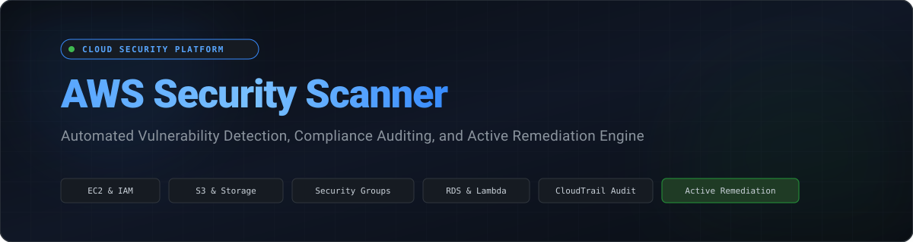
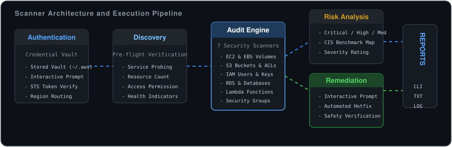
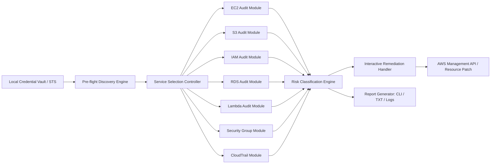
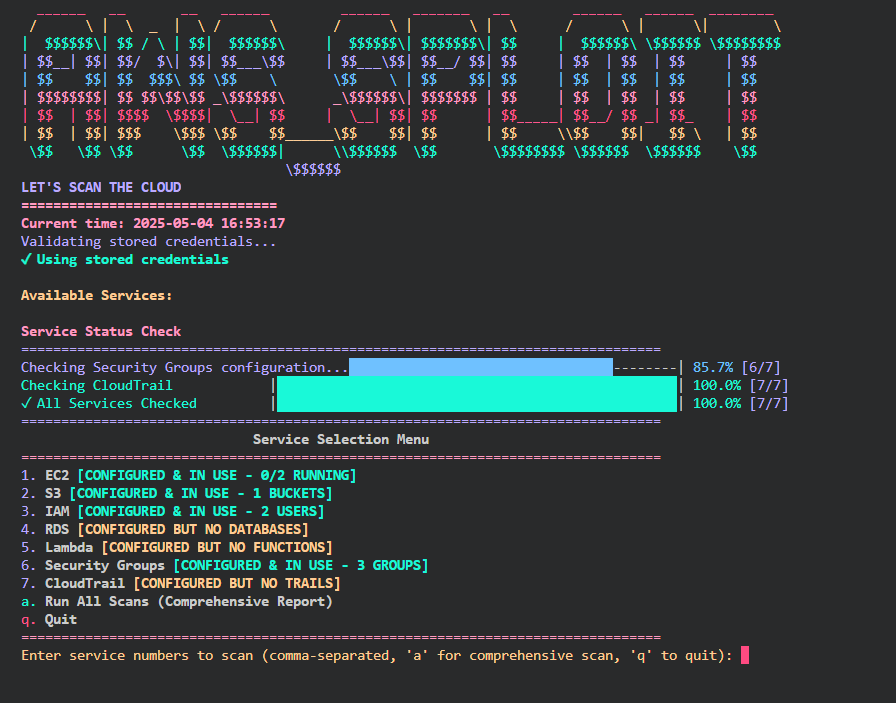
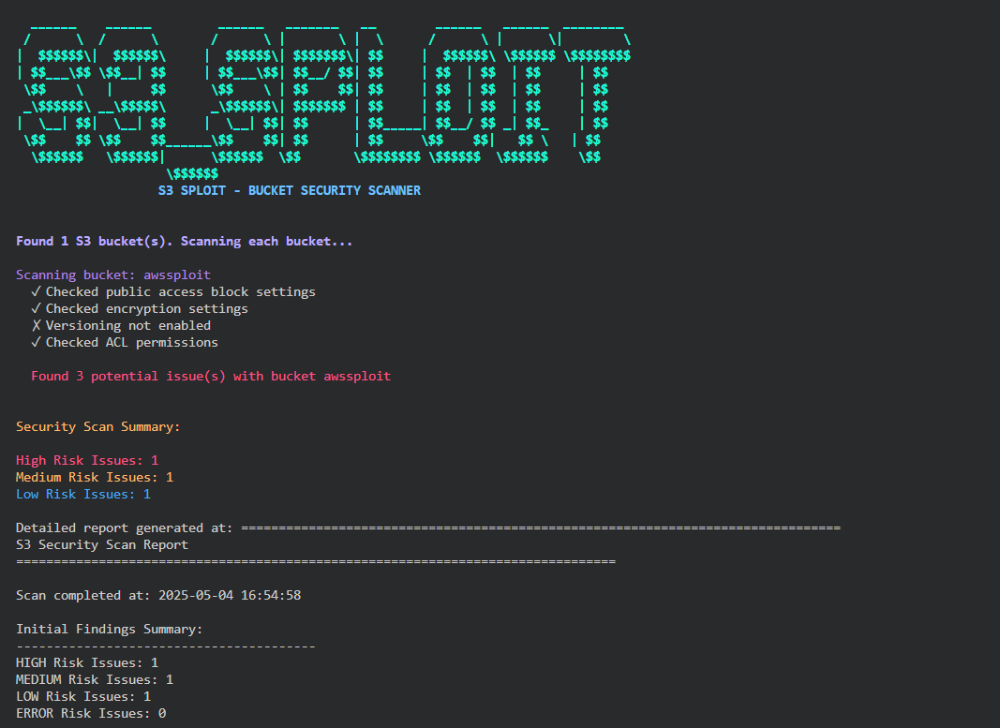
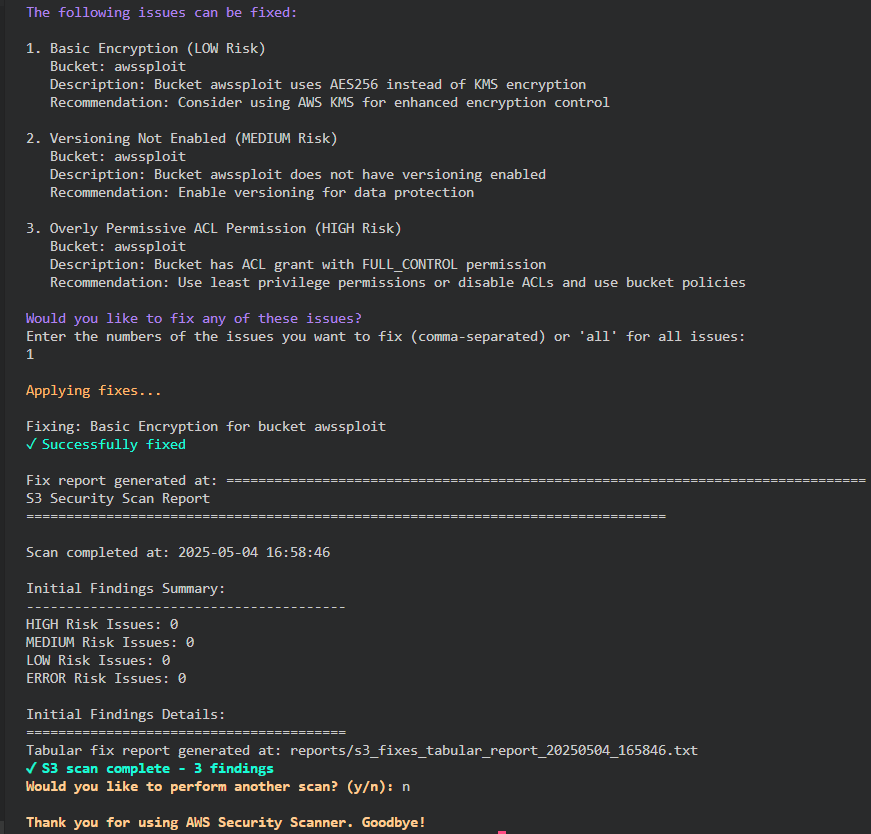
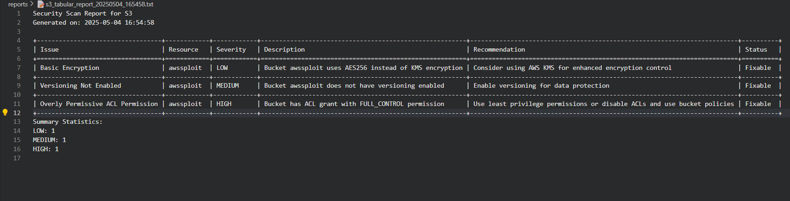
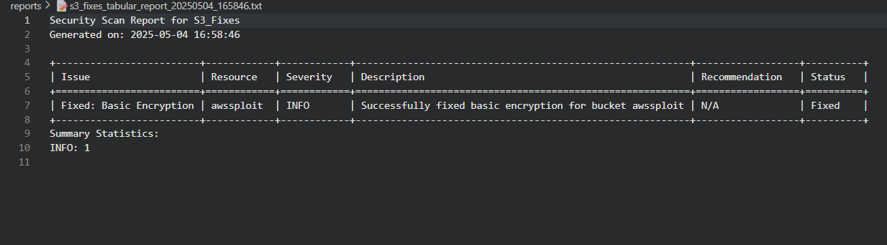
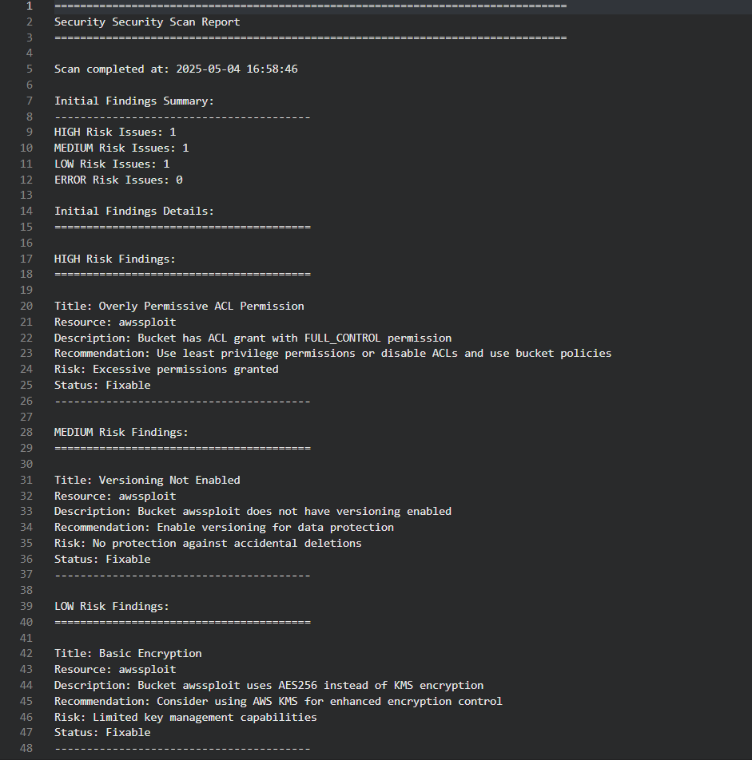

<p align="center">
  
</p>

<p align="center">
  <a href="https://github.com/Androkal19/AWS_SPLOIT_TOOL/blob/main/LICENSE"></a>
  <a href="https://www.python.org/downloads/"></a>
  <a href="https://aws.amazon.com/sdk-for-python/"></a>
  
  
  
  
</p>

---

## Table of Contents

- [Executive Overview](#executive-overview)
- [How It Works](#how-it-works)
- [Core Architecture](#core-architecture)
- [Key Features](#key-features)
- [Supported Services and Security Audits](#supported-services-and-security-audits)
- [Interactive and Automated Remediation](#interactive-and-automated-remediation)
- [Quick Start and Execution](#quick-start-and-execution)
- [IAM Policy Requirements](#iam-policy-requirements)
- [Usage Guide](#usage-guide)
- [Interface and Reports Gallery](#interface-and-reports-gallery)
- [Sample Report Output](#sample-report-output)
- [Security and Operational Safety](#security-and-operational-safety)
- [Contributing](#contributing)
- [License](#license)

---

## Executive Overview

Cloud security misconfigurations represent the primary vector for unauthorized access and data exfiltration across enterprise cloud environments. **AWS Security Scanner** is a specialized security assessment and active remediation framework engineered in Python. It executes comprehensive posture evaluations across core Amazon Web Services (AWS) resources, identifies critical exposure vectors, and provides interactive, single-click remediation workflows directly within your terminal.

The tool inspects live resource configurations against industry benchmarks, identifies compliance discrepancies, highlights dangerous access patterns, and exports actionable technical reports for DevOps, SecOps, and compliance teams.

---

## How It Works

The following animated terminal recording illustrates the end-to-end execution lifecycle: credential validation, pre-flight service checks, multi-service vulnerability discovery, interactive vulnerability remediation, and automated audit report generation.

<p align="center">
  
</p>

### Execution Lifecycle Stages

1. **Authentication and Session Initialization**: The scanner securely validates credentials via AWS STS (`GetCallerIdentity`), checking region configuration and IAM caller privileges.
2. **Pre-flight Service Discovery**: Probes target services (EC2, S3, IAM, RDS, Lambda, Security Groups, CloudTrail) to establish active inventory and inspect API accessibility.
3. **Deep Heuristic Inspection**: Scans resource attributes, encryption parameters, public endpoints, and identity policies against security controls.
4. **Vulnerability Classification**: Aggregates findings into standard risk levels: Critical, High, Medium, and Low.
5. **Interactive In-Place Remediation**: Surfaces detected risks with remediation advice, giving operators the choice to execute instantaneous configuration fixes.
6. **Report Compilation**: Persists timestamped findings into service-level audits and consolidated executive summaries.

---

## Core Architecture

AWS Security Scanner separates credential resolution, service enumeration, heuristic auditing, and remediation handlers into decoupled modules.

<p align="center">
  
</p>



---

## Key Features

- **Multi-Service Security Evaluation**: Out-of-the-box assessment coverage across compute, storage, identity, database, serverless, and network layers.
- **Active In-Place Remediation**: Interactive prompts allow administrators to resolve non-compliant resources (e.g., revoking open SSH CIDRs, enforcing S3 encryption) during the audit session.
- **Pre-flight Resource Verification**: Inspects which services are active, counting live resources before initiating full evaluations to avoid redundant API polling.
- **Encrypted Credential Management**: Local credential store with strict permission boundaries (`0o600` / `0o700`) and seamless validation through AWS STS.
- **Dual Assessment Modes**: Run granular, service-specific scans for targeted debugging, or trigger comprehensive account-wide audits with unified reporting.
- **Zero-Dependency Reporting**: Generates clean, human-readable tabular terminal outputs and timestamped text reports without requiring external cloud aggregators or SaaS accounts.

---

## Supported Services and Security Audits

| AWS Service | Audit Check / Policy Verified | Risk Severity | Automated Remediation |
| :--- | :--- | :---: | :---: |
| **Amazon EC2** | Public IPv4 address allocation on instances | High | Available |
| **Amazon EC2** | Unencrypted EBS storage volumes attached to workloads | High | Available |
| **Amazon EC2** | Instance Metadata Service v1 (IMDSv1) enforcement status | Medium | Available |
| **Amazon EC2** | Termination protection and detailed monitoring configurations | Low | Available |
| **Amazon S3** | S3 Public Access Block settings disabled | Critical | Available |
| **Amazon S3** | Bucket Access Control Lists (ACLs) granting `AllUsers` access | Critical | Available |
| **Amazon S3** | Bucket policies exposing wildcard `*` principal permissions | High | Available |
| **Amazon S3** | Missing server-side encryption (SSE-S3 / SSE-KMS) | High | Available |
| **Amazon S3** | Bucket versioning and access logging disabled | Medium | Available |
| **AWS IAM** | Active root account access keys or missing root MFA | Critical | Guided |
| **AWS IAM** | IAM user access keys older than 90 days | Medium | Available |
| **AWS IAM** | Unused credentials inactive for greater than 30 days | Low | Available |
| **AWS IAM** | Overly permissive policies (`AdministratorAccess` or wildcard `*`) | High | Guided |
| **AWS IAM** | Weak account password complexity and expiration requirements | Medium | Available |
| **Amazon RDS** | Publicly accessible relational database instances | Critical | Available |
| **Amazon RDS** | Storage encryption disabled on database instances | High | Available |
| **Amazon RDS** | Automated backups and backup retention period disabled | High | Available |
| **Amazon RDS** | Multi-AZ deployment missing on critical database instances | Medium | Available |
| **AWS Lambda** | Over-privileged function execution roles | High | Guided |
| **AWS Lambda** | Plaintext environment variables without dedicated KMS keys | Medium | Available |
| **AWS Lambda** | Function URLs configured with public authentication type (`NONE`) | Critical | Available |
| **AWS Lambda** | Deprecated execution runtimes | Low | Guided |
| **VPC Security Groups** | Ingress `0.0.0.0/0` on management ports (SSH 22, RDP 3389) | Critical | Available |
| **VPC Security Groups** | Ingress `0.0.0.0/0` on database ports (3306, 5432, 1433, 27017, 6379) | Critical | Available |
| **VPC Security Groups** | Unrestricted all-traffic rules (`-1` protocol from `0.0.0.0/0`) | Critical | Available |
| **VPC Security Groups** | Default security groups containing active ingress/egress rules | High | Available |
| **AWS CloudTrail** | Missing multi-region audit trails | High | Available |
| **AWS CloudTrail** | CloudTrail logging status disabled or paused | Critical | Available |
| **AWS CloudTrail** | Log file integrity validation disabled | Medium | Available |
| **AWS CloudTrail** | CloudWatch Logs integration and KMS CMK encryption missing | Medium | Available |

---

## Interactive and Automated Remediation

The scanner bridges the gap between passive auditing and active security operations by providing automated remediation routines.

### Remediation Workflow

```
[Finding Detected] -> [Display Context & Severity] -> [Interactive User Prompt]
                                                              |
                  +-------------------------------------------+
                  |                                           |
             [Select: YES]                               [Select: NO]
                  |                                           |
       [Execute API Remediation]                      [Log as Unresolved]
                  |                                           |
       [Validate Resource State]                              v
                  |                                   [Proceed to Next]
                  v
       [Update Audit Status: FIXED]
```

1. **Pre-execution Review**: For every identified vulnerability, the scanner prints the resource identifier, affected service, associated security risk, and recommended fix.
2. **Operator Authorization**: Fixes are never applied silently. The user is prompted to authorize the action (`yes/no`).
3. **Execution**: The tool utilizes the AWS SDK (`boto3`) to issue authorized corrective mutations (e.g., calling `revoke_security_group_ingress`, `put_public_access_block`, or `update_access_key`).
4. **Validation and Audit Logging**: Changes are immediately audited to verify that the remediation succeeded, and results are recorded in the final scan summary.

---

## Quick Start and Execution

AWS Security Scanner is distributed as a self-contained, standalone executable. It packages the scanning runtime, dependency libraries, and reporting engine into a single binary. **No Python installation or external dependency setup is required on target systems.**

### Running the Standalone Executable

1. **Download or Clone the Repository**:
   ```bash
   git clone https://github.com/Androkal19/AWS_SPLOIT_TOOL.git
   cd AWS_SPLOIT_TOOL
   ```

2. **Launch the Scanner Binary**:
   ```powershell
   # Windows PowerShell / CMD
   .\dist\AWS_Security_Scanner.exe
   ```

3. **Provide AWS Credentials**:
   On initial launch, the scanner prompts for your AWS Access Key, Secret Key, and target Region, which are securely validated via AWS STS and cached locally with restricted permissions (`0o600`). If your environment already configures standard AWS CLI environment variables (`AWS_ACCESS_KEY_ID`, `AWS_SECRET_ACCESS_KEY`, `AWS_DEFAULT_REGION`), they are detected automatically.

---

## IAM Policy Requirements

To run read audits across all supported services without remediation, attach the AWS managed policy `arn:aws:iam::aws:policy/SecurityAudit` to your scanning identity.

To enable interactive remediation capabilities, ensure your IAM identity has permissions for specific corrective actions, as demonstrated in the following minimal baseline:

```json
{
  "Version": "2012-10-17",
  "Statement": [
    {
      "Sid": "SecurityScannerAuditing",
      "Effect": "Allow",
      "Action": [
        "ec2:Describe*",
        "s3:GetBucket*",
        "s3:ListAllMyBuckets",
        "s3:GetAccountPublicAccessBlock",
        "iam:Get*",
        "iam:List*",
        "rds:Describe*",
        "lambda:List*",
        "lambda:GetFunctionConfiguration",
        "cloudtrail:DescribeTrails",
        "cloudtrail:GetTrailStatus"
      ],
      "Resource": "*"
    },
    {
      "Sid": "SecurityScannerRemediation",
      "Effect": "Allow",
      "Action": [
        "ec2:RevokeSecurityGroupIngress",
        "ec2:ModifyInstanceMetadataOptions",
        "s3:PutPublicAccessBlock",
        "s3:PutBucketEncryption",
        "iam:UpdateAccessKey",
        "cloudtrail:StartLogging",
        "cloudtrail:UpdateTrail"
      ],
      "Resource": "*"
    }
  ]
}
```

---

## Usage Guide

### Launching the Scanner

Execute the standalone binary:

```powershell
.\dist\AWS_Security_Scanner.exe
```

### Interactive Menu Workflow

Upon startup, the scanner executes credential validation and displays the service selection menu:

```text
Service Selection Menu
================================================================================
1. EC2             [CONFIGURED & IN USE - 4/4 RUNNING]
2. S3              [CONFIGURED & IN USE - 18 BUCKETS]
3. IAM             [CONFIGURED & IN USE - 12 USERS]
4. RDS             [CONFIGURED & IN USE - 2/2 RUNNING]
5. Lambda          [CONFIGURED & IN USE - 15 FUNCTIONS]
6. Security Groups [CONFIGURED & IN USE - 14 GROUPS]
7. CloudTrail      [CONFIGURED & IN USE - 1/1 ACTIVE]
a. Run All Scans (Comprehensive Report)
q. Quit
================================================================================
```

- Enter individual service numbers (`1`, `2`, `3`, etc.) or comma-separated lists (`1, 2, 6`) to audit specific services.
- Enter `a` to initiate a full scan of all seven modules with an aggregated report.
- Enter `q` to safely exit the tool.

---

## Interface and Reports Gallery

The following captures highlight key operational interfaces of AWS Security Scanner:

| Interface | View | Description |
| :--- | :--- | :--- |
| **Main Interface** |  | Terminal dashboard with credential verification and service status inspection. |
| **Active Scan Execution** |  | Live progress indicators and multi-threaded audit output. |
| **Interactive Remediation** |  | In-session prompts displaying finding details, risks, and fix execution. |
| **Misconfiguration Overview** |  | Tabular assessment of discovered risks grouped by severity. |
| **Remediation Results** |  | Audit confirmation showing successful state remediation. |
| **Consolidated Summary** |  | Executive summary containing counts and breakdown of all assessed services. |

---

## Sample Report Output

Each audit run automatically compiles dual artifacts in the `output/` directory: an executive-grade plain text assessment (`.txt`) and an interactive, print-ready HTML dashboard (`.html`):

```text
+==============================================================================+
|                   AWS INFRASTRUCTURE SECURITY AUDIT REPORT                   |
|         Confidential // Security Operations & Compliance Assessment          |
+==============================================================================+
| Target Scope         : INFRASTRUCTURE                                        |
| Assessment Framework : CIS AWS Foundations v3.0 | NIST SP 800-53 Rev 5       |
| Generation Timestamp : 2026-10-31 12:45:00 UTC                               |
| Overall Posture      : Grade C (60/100) - ELEVATED RISK / REMEDIATION REQUIRED|
+==============================================================================+

--------------------------------------------------------------------------------
1. EXECUTIVE SUMMARY & POSTURE OVERVIEW
--------------------------------------------------------------------------------
+------------------+---------+---------------------------------------------------------------------+
| Severity Class   |   Count | Risk Definition                                                     |
+==================+=========+=====================================================================+
| CRITICAL         |       1 | Immediate vulnerability; direct public exposure or root compromise  |
| HIGH             |       1 | Elevated risk; missing mandatory encryption or over-permissive ACLs |
| MEDIUM           |       0 | Security hygiene discrepancy; unrotated credentials or logging gaps |
| LOW / INFO       |       0 | Defense-in-depth deviation; minor hardening recommendation          |
| RESOLVED         |       1 | Issues successfully corrected during interactive remediation        |
+------------------+---------+---------------------------------------------------------------------+

TOTAL AUDITED FINDINGS: 3 | REMEDIATION ACTION REQUIRED: 2

--------------------------------------------------------------------------------
2. COMPREHENSIVE FINDINGS CATALOG & THREAT ANALYSIS
--------------------------------------------------------------------------------

[+] CRITICAL SEVERITY FINDINGS (1 Discovered)
================================================================================

  Reference ID : [SEC-SEC-001] Unrestricted Ingress on Port 22 (SSH)
  Target Svc   : Security Groups      | Severity  : [CRITICAL]
  Resource ID  : sg-04a8b29c11a01ef32
  Compliance   : CIS AWS Foundations 5.1, NIST SP 800-53 SC-7, PCI-DSS 1.3
  Status       : ACTION REQUIRED
  --------------------------------------------------------------------------
  Threat Analysis:
    Security group rule permits 0.0.0.0/0 inbound to TCP port 22.
  Risk Exposure:
    Direct brute-force and remote exploit attacks from the public internet.
  Remediation Procedure:
    Restrict ingress to trusted CIDR blocks via VPC bastion or VPN.
  --------------------------------------------------------------------------
```

---

## Security and Operational Safety

- **Read-First Methodology**: Inspection functions operate independently from remediation functions. No modifications occur without explicit confirmation.
- **Local Secret Isolation**: Credential data saved through the manager is stored locally in `~/.aws_security_scanner/credentials.json` with restricted filesystem permissions (`0o600`).
- **Audit Logging**: Every remediation action produces timestamped log entries documenting the prior state, mutation action, and post-state verification.
- **Operational Boundaries**: For production accounts, run initial scans using read-only IAM credentials before assigning remediation permissions.

---

## Contributing

Contributions from the security and cloud engineering communities are welcome. To contribute:

1. Fork the repository.
2. Create a targeted branch (`git checkout -b feature/new-service-scanner`).
3. Commit your enhancements (`git commit -m 'Add inspection rule for EKS cluster security'`).
4. Push to your branch (`git push origin feature/new-service-scanner`).
5. Open a Pull Request detailing your changes, test evidence, and threat model rationale.

---

## License

This project is licensed under the MIT License. See the [LICENSE](LICENSE) file for complete terms.
